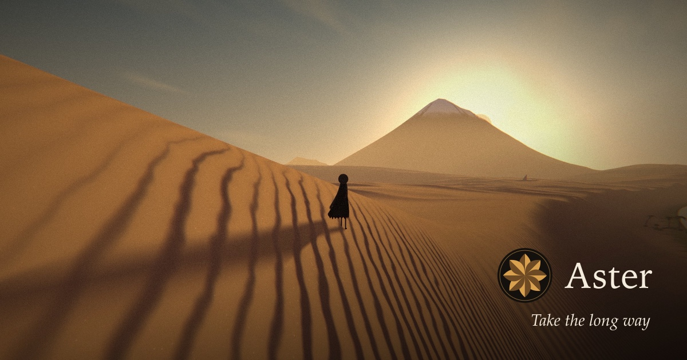
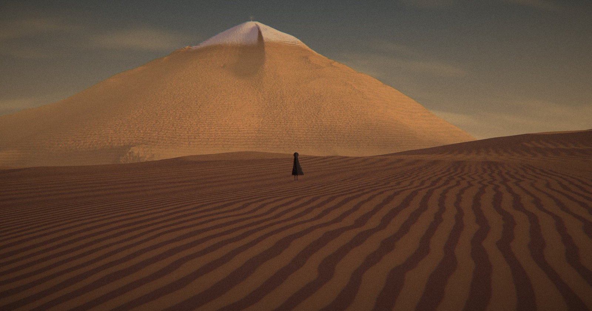
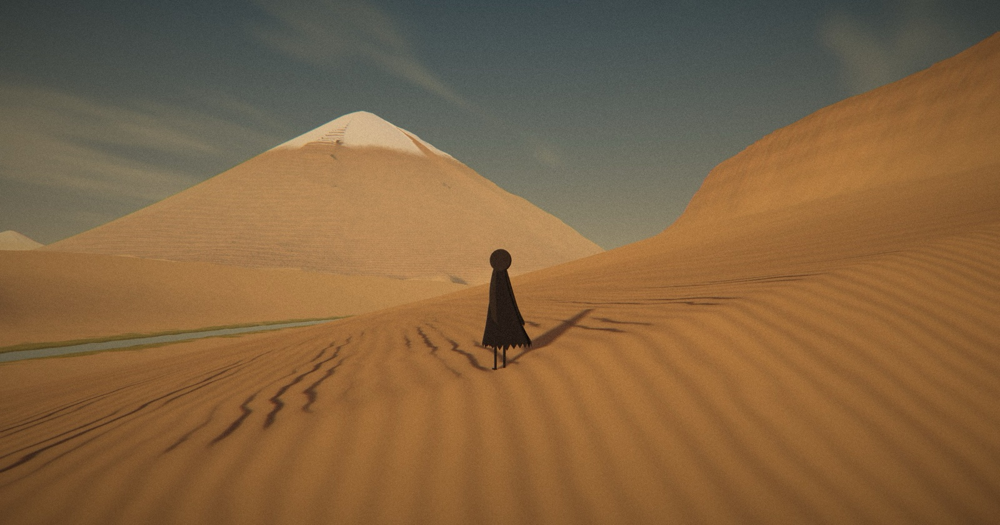
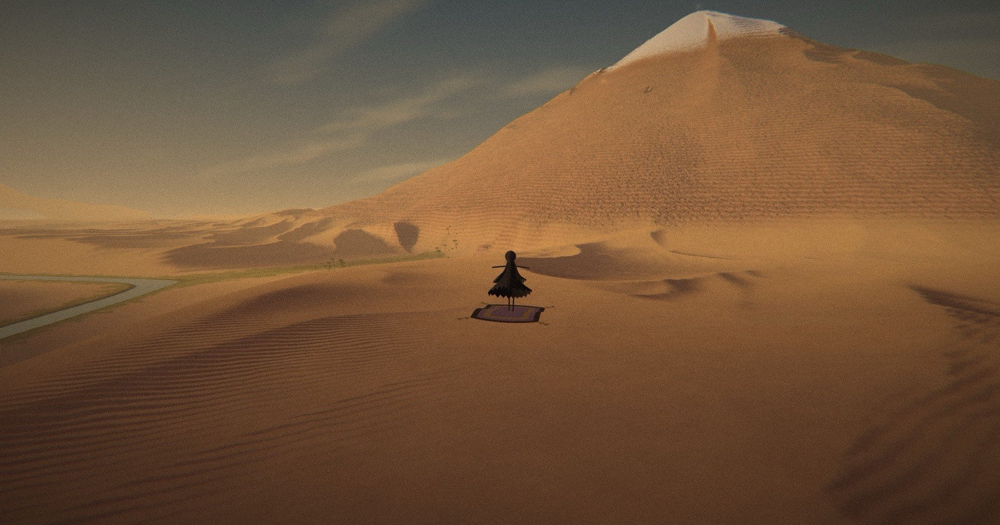
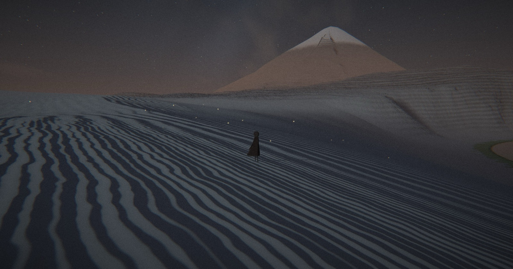
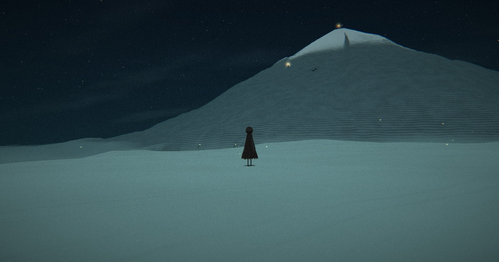

# Aster

Take the long way.

A calm desert to wander, glide and fly through. It runs in the browser, there's nothing to install, and nobody tells you where to go.

**[Play it](https://miguelsolorio.com/projects/aster/)**



## What's out there

You start on foot in open sand with a city somewhere in sight. The rest is yours to find: dune seas, salt pans, river gorges, walled towns, caravans on the road between them, and a snow-capped mountain on most horizons. Out on the sand there are empty hamlets round their wells and lone watchtowers with a fire lit at night. Most mountains have a village or two at their foot, with garden terraces, a tower and goats grazing outside. People live in them: stop and talk. People live out on the open ground too, wherever it suits them: black tents round a well, an observatory on a hilltop, salt pools on a pan, glass kilns that glow from dusk, houses stacked under a rock face, a village along a bridge, a caravanserai half way down a route, a dyers' town with cloth on every roof, a town of wind towers and, rarely, a city built up in five tiers to a gold dome. Each has one person worth stopping for, who puts something you haven't found on your map. The watcher under the tower, in blue, and the old climber by the fire, in green, each know where something useful was left. One of those mountains has a road to it: follow the torches out of the desert, through a stone gate where the sand turns to snow, and up the flank to three villages and a lantern hold at the top. The sun rises and sets while you walk, so the same ridge looks different every time you come back to it.

Some days a sandstorm crosses the desert. You'll see it first: a brown wall on one horizon, the wind coming round to meet it, caravans kneeling in the road. A board outruns it and feet don't. Inside you can see about forty metres, the sun is gone, and the compass forgets what it was pointing at. Fly with one behind you and it's the fastest you'll ever go. Storms part round mountains, so a village at the foot of one is a good place to wait, and so is a cavern or a bedroll. When it has passed, walk the ground it crossed. Now and then it has dug something up.

Rain is rarer. One dark cloud comes over with grey under it, and if the sun is low behind you there's a bow against it. Where it falls the sand goes dark. A salt pan holds the water and turns into a mirror. A few hours later the dunes it crossed are in flower, a different colour on each rise, and the animals come out to graze. By the next day it's sand again.

If you'd sooner have none of it, turn Weather off in the menu, under Game.

Some places are waiting for someone. The hamlets out on the sand are empty and their wells are dry, the lone watchtowers are cold, and nothing grows below a mountain spring. Each wants one thing carried to it: water from any river or pool, a flame from a lantern tower, date stones from a grove or an oasis. `E` picks a thing up and `E` hands it over. Then leave it alone for a day or two. People move into a hamlet with water in its well, and a caravan camps beside it. A lit tower gets a keeper, and its beacon shows at night from further off than the tower does. The date stones are a grove in three days. A small dot on the map marks what you've brought back.

You carry a map, and it starts empty. Ground is washed in as you see it, towns and finds are inked in once you reach them, and it's all kept between visits. When someone sends you after something, a dashed circle goes on the map over roughly where to look.

A thin compass runs along the top of the view, so "north-east, a fair walk" means something. Under it sit the few places you already know to head for: a small ring for an errand, a thread of light for a place marked through the spyglass, a tent for your bedroll. One that waits dimmed at an end of the strip is off to that side or behind you.

| | |
|---|---|
|  |  |
|  |  |
|  |  |
|  |  |

There are 20 of these in [docs/screenshots](docs/screenshots).

## Controls

| Key | What it does |
|---|---|
| `W` `A` `S` `D` | Run |
| Mouse | Look |
| `Space` | Leap. Hold to rise, let go to glide, double-tap to drop |
| `Q` | Step on or off the board, once you have one (or get off an animal) |
| `E` | Talk, fill the waterskin, take a flame or date stones, give them to a place that wants them, or climb onto a wild ass, an oryx (come up to one on foot) or a caravan's camel, and get off again. The key shows over whichever is nearest |
| `F` | Hold up the spyglass, once you have one |
| `R` | Play the flute, once you have one. A tap plays the song that suits where you stand; hold it to choose one |
| `B` | Lay the bedroll and sleep in it, once you have one |
| `M` | Open the map. `W` `A` `S` `D` move it, the wheel zooms |
| `Esc` | Menu and photo mode |

It plays on a phone too, with touch controls.

## Run it locally

You need Node.

```bash
npm install
```

```bash
npm run dev
```

`npm run build` type-checks and builds the site into `dist`. Pushing to `main` deploys it to GitHub Pages.

## Dev pages

The dev server has a few extra pages that aren't part of the build:

- `/gallery.html` shows every look the game can render in
- `/characters.html` and `/equipment.html` show the figures, boards, carpets and picks
- `/social.html` runs the game in a 1200 × 630 frame for capturing screenshots like the ones above

A few URL options help when testing. `?tools=board,carpet,pick,spyglass,flute,bedroll,rod,chart,rope,boots,feather` lends you the tools for one visit, `?songs=waking,wind,rain,opening` lends you the songs the same way, `?carry=water,flame,seed` lends you things to carry, `?day=0.72` starts at a set time of day (0 is midnight, 0.5 is noon), `?storm` starts with a sandstorm a minute away (`?storm=in` starts inside one), `?rain` does the same for rain (`?rain=in` starts under it, `?rain=after` starts on the wet ground it left), `?miner` drops you in front of a city's miner (`?miner=2` for the second-nearest city to the default start), and on the dev server `?village` starts you in the nearest mountain village (`?village=snow` for the nearest snow village), and `?settle=<kind>` (`well-camp`, `star-house`, `salt-works`, `glass-kilns`, `ledge`, `bridge`, `caravanserai`, `dyers-town`, `wind-towers` or `stepped-city`) puts you 45 m from the nearest such settlement.

## Built with

[three.js](https://threejs.org), TypeScript and Vite. The terrain, sky and water are custom shaders, and the world is generated from a seed, so there are no texture or model files to download.
