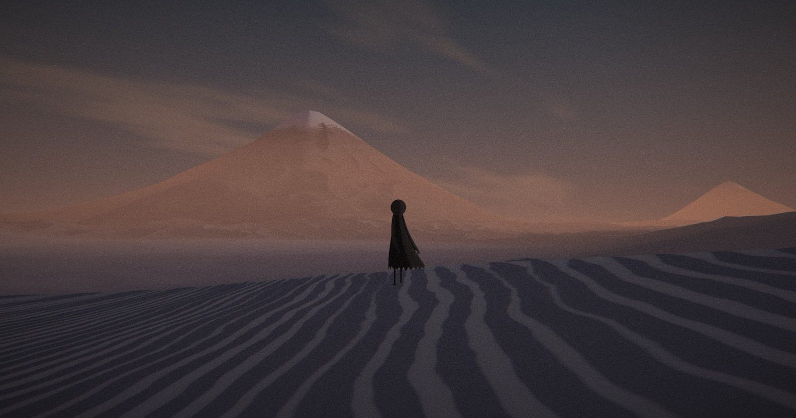
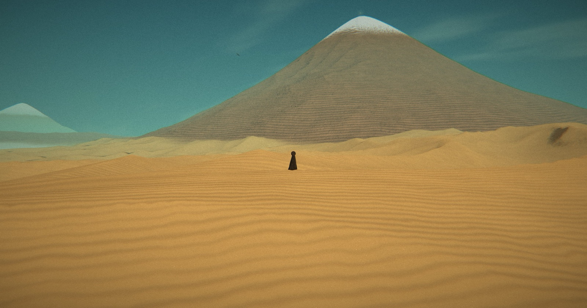
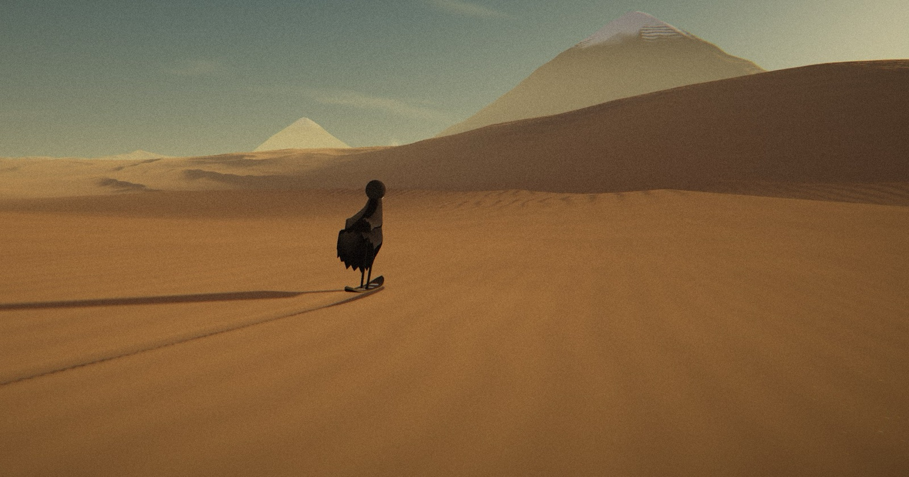

# Aster

Take the long way.

A calm desert to wander, glide and fly through. It runs in the browser, there's nothing to install, and nobody tells you where to go.

**[Play it](https://miguelsolorio.com/projects/aster/)**


## What's out there

You start on foot in open sand with a city somewhere in sight. The rest is yours to find: dune seas, salt pans, river gorges, walled towns, caravans on the road between them, and a snow-capped mountain on most horizons. One of those mountains has a road to it: follow the torches out of the desert, through a stone gate where the sand turns to snow, and up the flank to three villages and a lantern hold at the top. The sun rises and sets while you walk, so the same ridge looks different every time you come back to it.

| | |
|---|---|
|  |  |
|  |  |
|  |  |
|  |  |

There are 20 of these in [docs/screenshots](docs/screenshots).

## Controls

| Key | What it does |
|---|---|
| `W` `A` `S` `D` | Walk |
| Mouse | Look |
| `Shift` | Run, or boost in the air |
| `Space` | Leap. Hold to rise, let go to glide, double-tap to drop |
| `Q` | Step on or off the board, once you have one (or get off an animal) |
| `E` | Talk, or climb onto a wild ass or oryx (walk up to one, don't run) and get off again |
| `F` | Hold up the spyglass, once you have one |
| `R` | Play the flute, once you have one |
| `B` | Lay the bedroll and sleep in it, once you have one |
| `Esc` | Menu and photo mode |

It plays on a phone too, with touch controls.

## Run it locally

You need Node.

```bash
npm install
```

```bash
npm run dev
```

`npm run build` type-checks and builds the site into `dist`. Pushing to `main` deploys it to GitHub Pages.

## Dev pages

The dev server has a few extra pages that aren't part of the build:

- `/gallery.html` shows every look the game can render in
- `/characters.html` and `/equipment.html` show the figures, boards, carpets and picks
- `/social.html` runs the game in a 1200 × 630 frame for capturing screenshots like the ones above

Two URL options help when testing. `?tools=board,carpet,pick,spyglass,flute,bedroll,rod,chart,rope` lends you the tools for one visit, `?day=0.72` starts at a set time of day (0 is midnight, 0.5 is noon), and `?miner` drops you in front of a city's miner (`?miner=2` for the second-nearest city to the default start).

## Built with

[three.js](https://threejs.org), TypeScript and Vite. The terrain, sky and water are custom shaders, and the world is generated from a seed, so there are no texture or model files to download.
